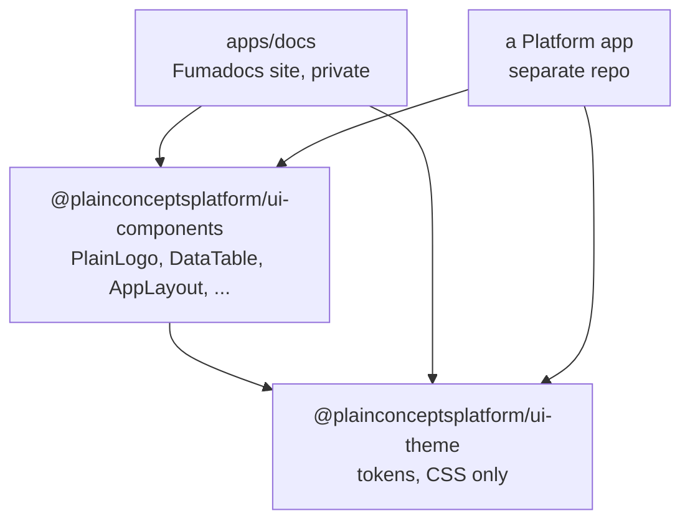
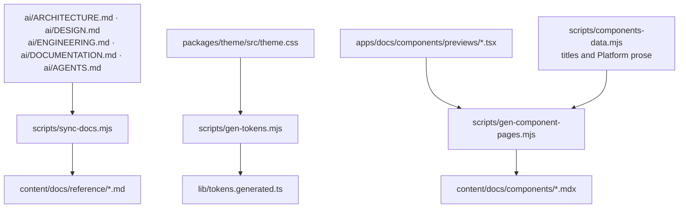
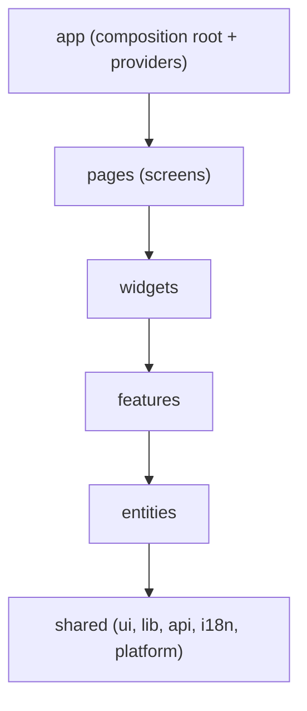
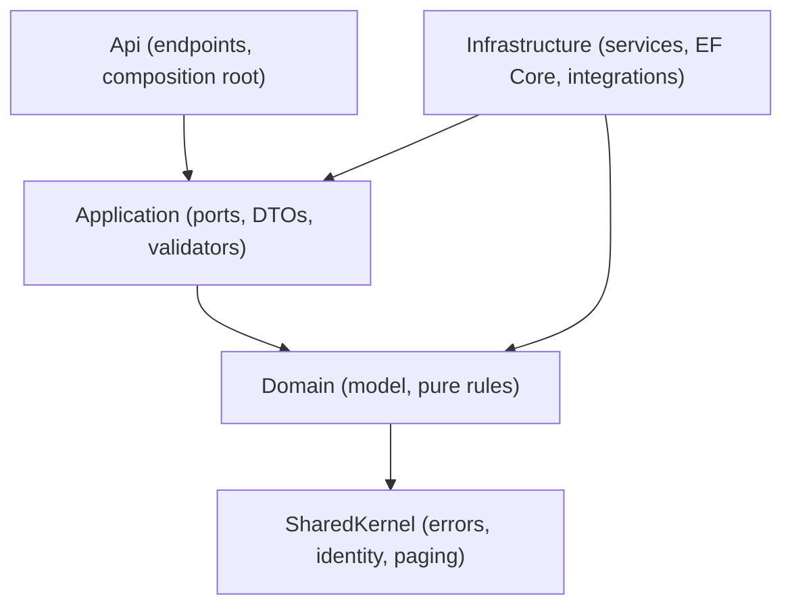

# ARCHITECTURE

Reference architecture for PlainConcepts **Platform** apps (frontend and backend), the contract the Platform app family shares, and the layout of this foundation repo. It mandates a few rules that matter and leaves the rest to each team. Start simple; add structure only when it earns its place.

The rules here describe what the family apps actually run. Kitchen-Sink is the reference app (internal: requires access to the PlainConceptsPlatform organisation): when this document and Kitchen-Sink disagree, Kitchen-Sink is the version that runs, and this document is the one to fix.

## Architecture Overview

- **Foundation repo** (`PlainConceptsPlatform/Foundations`): a pnpm monorepo holding the shared theme package, the shared components package, the docs/showcase site, and the conventions in `ai/`. It ships tokens, shared components and docs, and it defines the family's platform contract. It does **not** ship the platform code itself.
- **Platform frontend apps** (separate repos): a **React** single-page app in **TypeScript**, built by **Next.js as a static export** and routed client-side by **react-router**. The API serves the export, so the browser talks to one origin. Components are **shadcn/ui** copied in and themed by `@plainconceptsplatform/ui-theme`. Code is organised by **Feature-Sliced Design (FSD)** with the canonical `pages/` layer, and **Steiger** enforces the boundaries.
- **Platform backend apps** (.NET): a modular monolith in Clean Architecture layers. Each bounded context has services behind Application ports, domain exceptions map to one error envelope, services are registered by hand, **Aspire** composes the system locally and **Azure Container Apps** runs it. See [Backend architecture](#backend-architecture-net).
- **The Platform app family**: Numa, Odyssey, Hermes and Kitchen-Sink share their platform code (session and auth, permissions, audit, feature flags, errors, security headers, the API surfaces, the web shell) and keep it identical. Kitchen-Sink is the reference app **and** the Copier template that distributes that code. See [Platform family](#platform-family).

## Stack

Every app picks the **same** library for the same job, so codebases (and AI agents) stay predictable. Prefer these; deviate only with a good reason recorded in the app. Where the family apps made a different choice, the last column says so, and a family app follows that column.

### Core

| Concern | Choice | Notes | Family apps |
|---|---|---|---|
| Language | **TypeScript (strict)** | extends `tsconfig.base.json` | same |
| Framework | **Next.js** + **React** | `output: "export"`: Next is the build shell, one page mounts the SPA, and **react-router** decides every route | same; the API serves the export from `wwwroot` |
| Package manager | **pnpm** | used everywhere, incl. this repo | platform versions in a pnpm `platform` catalog |
| Components | **shadcn/ui** | copied into the app, on Radix + Tailwind | same |
| Primitives | **Radix UI** | comes with shadcn | same |
| Styling | **Tailwind CSS v4** | tokens from `@plainconceptsplatform/ui-theme` | same |
| Theme | **@plainconceptsplatform/ui-theme** | the Platform styleguide; tokens only | same, plus the platform `ThemeProvider` and anti-flash script from the template |
| Icons | **Lucide** (`lucide-react`) | shadcn default | **Tabler** (`@tabler/icons-react`) |
| Dependency injection | **inversify-hooks** | mandatory; see [Dependency injection](#dependency-injection-inversify-hooks-mandatory) | same, singletons under a constant `cid`, no decorators |
| Internationalization | **react-i18next + i18next** | mandatory; the only translation library. Zero magic strings; every user-facing text is a translation message | same, English and Spanish with a key-parity check |

### Feature libraries (shadcn delegates to these, use them directly)

| Need | Choice | Family apps |
|---|---|---|
| Forms + validation | **react-hook-form + zod** (`@hookform/resolvers`) | controlled state and a request builder; the API validates (FluentValidation, 422) |
| Data tables / grids | **TanStack Table** | the `DataTable` from `@plainconceptsplatform/ui-components` |
| Data fetching / server cache | **TanStack Query** | same, with one query-key factory per API area |
| Routing | **react-router** | same |
| Date picker / calendar | **react-day-picker** | same |
| Charts | **Recharts** | **Chart.js** through `react-chartjs-2` |
| Toasts / notifications | **sonner** | same |
| Command palette | **cmdk** | same |
| Carousel / Drawer | **embla-carousel** / **vaul** | same |

### Tooling

| Concern | Choice | Notes |
|---|---|---|
| Lint + format | **Biome** | one tool; scoped `biome.json` per package, never run at monorepo root |
| FSD boundaries | **Steiger** | `steiger src` in CI: no upward, sideways or deep imports between slices |
| Markdown lint | **markdownlint-cli2** | one rule, `no-hard-wrapped-prose`; `.markdownlint-cli2.jsonc` at the repo root, not scoped per package |
| Unit / component tests | **Vitest + Testing Library** | |
| E2E tests | **Playwright** | |
| Docs + showcase | **Fumadocs** (Next.js) | `apps/docs` |
| Monorepo | **pnpm workspaces** | no Turborepo/Nx yet |

### Deliberately not standardized as shared packages

Custom shared business components, auth/API/state-management abstractions, observability packages, feature-flag packages or engines (the section feature flag convention and its UI pieces are the exception, see [Section feature flags](#section-feature-flags)), routing wrappers, a custom CLI, shared form abstractions, a custom DI framework. Add a shared **package** only when the same real requirement has appeared in **multiple** apps.

The family's platform code (session, permissions, audit, errors, the API surfaces, the web shell) is not a package either. It is source code in each app, distributed by the Kitchen-Sink template and owned by it, so every app can read and debug it and nobody waits on a package release. See [Platform family](#platform-family).

## Foundation repo structure

```text
Foundations/
├── apps/
│   └── docs/                  # Fumadocs (Next.js static export), docs + live themed component previews
├── packages/
│   ├── theme/                 # @plainconceptsplatform/ui-theme (design tokens, CSS only)
│   └── ui-components/         # @plainconceptsplatform/ui-components (shared React components)
├── ai/                        # ARCHITECTURE.md (incl. Stack), DESIGN.md, ENGINEERING.md, DOCUMENTATION.md, AGENTS.md
│   └── workflows/             # README linking to the agentic-workflows repo
├── skills/                    # platform-onboard, platform-new-project, platform-upstream
├── biome.json · .markdownlint-cli2.jsonc · tsconfig.base.json · pnpm-workspace.yaml · package.json
└── .github/workflows/         # CI (lint, typecheck, build, generated content), deploy (static export → GitHub Pages)
```

## Foundation repo internals

How this repo produces what it publishes. Worth knowing before changing anything here, because several artifacts are generated and editing the output instead of the input is the usual mistake.

### Package graph



`ui-theme` has no dependencies of its own beyond a Tailwind peer, which is what keeps it cheap to adopt. `apps/docs` is private and never published; it consumes both packages through the workspace so the site always documents the code in the same commit.

### Content pipeline

Three generators run before the site builds. The component pages and the token module are committed so they are reviewable in a diff, and CI fails if regenerating them produces a change. The reference pages synced from `ai/*.md` are gitignored and rebuilt on every `dev` and `build`.



The rule this encodes: **`ai/*.md` and `theme.css` own facts, and the site renders them.** A fact stated in two places drifts, so narrative pages link to the reference rather than restating a table.

### Release flow

Releases are manual and deliberate. A pull request that changes a package bumps its `version` and adds the entry to its `CHANGELOG.md`. After it merges, a maintainer publishes from `main` with `pnpm release:theme` or `pnpm release:components`. Each script builds the components, typechecks the workspace and runs `pnpm publish --access public` for that one package. Apps pick the change up when they bump the dependency. No workflow publishes, and there are no changesets.

### Deploy topology

`apps/docs` builds with `output: "export"` and is served as static files from GitHub Pages at [platform.plainconcepts.dev](https://platform.plainconcepts.dev). There is no server and no sign-in: the site is public. The deploy workflow is gated on CI: it triggers on `workflow_run` completion and only proceeds when the CI conclusion was a success.

## Reference app structure (FSD on a Next.js static export)

```text
apps/web/
├── app/              # Next.js router: the root layout (fonts, theme script) and one page that mounts the SPA
├── pages/.gitkeep    # empty on purpose: a root pages/ stops Next from reading src/pages as the Pages Router
└── src/
    ├── app/          # FSD app layer: composition root, providers, query client, router, global styles
    ├── pages/        # FSD pages layer: one slice per route, e.g. pages/claims/ui/ClaimsPage.tsx
    ├── widgets/      # (earn it) self-contained UI blocks combining features/entities, e.g. the app shell
    ├── features/     # (earn it) user interactions / use-cases
    ├── entities/     # (earn it) business domain models + their UI/api
    └── shared/
        ├── ui/       # shadcn components (Radix + Tailwind)
        ├── lib/      # cn(), formatters, pure helpers
        ├── api/      # API contracts and their HTTP implementations
        ├── i18n/     # i18next setup and the locale files
        └── platform/ # family apps: the platform web code the template delivers (shell, theme provider, auth, flags)
```

The Next.js router folder is the root `app/`, outside `src/`, and the FSD layers live in `src/`. The layer names are the canonical FSD ones, and slices use the canonical segments (`ui/`, `model/`, `api/`, `lib/`, `config/`), so `pages/claims/ui/ClaimsPage.tsx`, never a renamed layer or a flat file per page.

A brand-new app may start with only `app/`, `pages/`, and `shared/`. Introduce `widgets/`, `features/`, and `entities/` **only when a real need appears**, never preemptively.

## Dependency direction

The one hard rule. A layer may import from layers **below** it, never above; siblings do not import each other (compose them one layer up). Steiger fails the build when an import breaks it.



*Rationale:* one-way dependencies keep slices independent and safe to delete/move, and make the codebase legible to humans and agents, you always know where a thing can live.

## Public APIs for slices

Every slice exposes a single `index.ts` (barrel). Import a slice **only** through its `index.ts`, never deep-reach into its internals. This makes each slice's surface explicit and refactor-safe.

## Where things belong

- **App initialization / providers**: `src/app` (composition root, query client, router and a `providers` module).
- **Routing**: react-router, configured in `src/app`; each route renders a screen from `pages/`. The Next.js `app/` folder only mounts the SPA.
- **Reusable domain logic**: `entities/` (models, domain rules) and `features/` (use-cases).
- **UI components**: third-party components in `shared/ui` (shadcn); app-specific components in the slice that owns them. Do **not** wrap third-party components "just in case".
- **API clients**: `shared/api` (or per-entity `api/`), behind small typed interfaces.
- **Hooks**: cross-cutting in `shared/lib`; feature-specific inside the feature.
- **Platform code** (family apps): `shared/platform/` on the web and `apps/api/src/Platform/` on the API, owned by the template.

## Dependency injection (inversify-hooks, mandatory)

Frontend apps use **[`inversify-hooks`](https://github.com/CKGrafico/inversify-hooks)** as the dependency-injection layer. Depend on interfaces, register implementations in the container, and resolve them in components through the hooks. This keeps use-cases and API clients swappable and testable, and gives every app the same wiring pattern.

- Library: `inversify-hooks`, which bundles inversify. Family apps take no direct `inversify` or `reflect-metadata` dependency.
- Build the container once, at module load, in a composition root under `src/app/providers/`, never inside `useEffect`. Register each contract as a singleton under a constant id (`container.addSingleton<IContract>(HttpContract, cid.IContract)`), because the default id comes from the class name, which a minifier rewrites.
- Resolve with `useInject` inside `pages`, `widgets`, and `features`. Keep `entities`/domain code free of the container.
- The underlying principle still holds: depend on abstractions, not concretions. The container is how we implement that here.

Decorators are optional: the family's container is a flat table of singletons and uses none. An app that does use `@injectable()` needs these compiler options, which the shared `tsconfig.base.json` already sets:

```json
{
  "compilerOptions": {
    "target": "es2020",
    "lib": ["es2020", "dom"],
    "moduleResolution": "bundler",
    "experimentalDecorators": true,
    "useDefineForClassFields": false
  }
}
```

## Testing conventions

- UI-only wrappers need not ship tests. Logic belongs in apps, not in this foundation repo.

## Naming conventions

- Files/folders: `kebab-case`, except React component files, which may be `PascalCase` (`ClaimsPage.tsx`). React components: `PascalCase` export. Hooks: `useX`.
- Slice folders are singular domain nouns (`user`, `invoice`), not `utils`-style grab-bags.
- One barrel `index.ts` per slice; no deep imports across slices.

## When a simpler structure is acceptable

Small/short-lived apps may collapse to `app/ + pages/ + shared/`. The dependency direction and slice public-API rules still apply; the extra layers are optional. Prefer the smallest structure that stays legible.

## Docs & showcase

`apps/docs` is a **Fumadocs** (Next.js) site rendering these docs plus live, themed component previews and 2-3 realistic screens. It demonstrates the *theme* and the *shared components* (from `@plainconceptsplatform/ui-components`); it links out to shadcn's official docs rather than re-documenting component APIs. It is a public static site on GitHub Pages (see [Deploy topology](#deploy-topology)).

## Platform family

Numa, Odyssey, Hermes and Kitchen-Sink are one family. Their business differs, and their platform code is the same code, kept identical over time. Every other Platform app is an **own design** app: it follows this document and the engineering standard, but its platform code is its own.

**Kitchen-Sink** (internal: requires access to the PlainConceptsPlatform organisation) is both things at once. It is the reference app, where every platform capability runs for real, and it is the [Copier](https://copier.readthedocs.io/) template that delivers that code to the other members. Template versions are Kitchen-Sink's `v*` tags.

### Every family module is mandatory

Auth and session, users, roles and permissions, settings, the audit log, email, impersonation, MCP, the changelog, health, security headers, rate limiting, i18n, the web shell, section feature flags, the guided tour, and the B2B surface. A family app carries all of them, so a fix in one reaches every app the same way.

### One owner per file

Every file in a family app has exactly one owner, and only that owner changes it.

| Owner | Files | How it changes them |
|---|---|---|
| **agent-harness** | `.opencode/**`, `.agents/**`, `opencode.jsonc`, `skills-lock.json`, and the `AGENTS.md`, `ARCHITECTURE.md` and `DESIGN.md` it generates | `npx @plainconceptsplatform/agent-harness update` |
| **agentic-workflows** | Every file with the `Managed by @plainconceptsplatform/workflows` header (router, workers, actions, evidence, `opencode.ci.json`, the compile script), and the `quality-gates` template (gate scripts and rules) | `npx @plainconceptsplatform/workflows update` |
| **Template** | Only the paths listed in `.platform/manifest`: the platform code, its deploy workflow, the Dockerfile shape, `Directory.Packages.Platform.props`, the pnpm `platform` catalog, the capability specs and `docs/platform/` | `copier update` |
| **App** | Everything else: the business, the catalogs (permissions, feature catalog, audit events), migrations, baselines, quality floors and environment configuration | the app's own pull requests |

Copier never touches harness or workflows files, and Kitchen-Sink's own CI fails when a manifest path is also managed by the harness or carries the workflows header.

### The family files

| File | Owner | Content |
|---|---|---|
| `.copier-answers.yml` | Copier (generated) | `_commit` (the template tag), `_src_path`, and the answers such as `app_name`. Its presence is the opt-in marker: harness and workflows features for the family do nothing in a repository without it. |
| `.platform/manifest` | Template | One gitwildmatch glob per line, relative to the repository root, `#` for comments. The list of platform-owned paths. |
| `.platform/exceptions.yml` | App | `exceptions: [{ path: <glob>, reason: <text>, issue: <url>, expires: YYYY-MM-DD }]`. The platform paths this app may diverge from, and until when. |

### Neutral platform paths

Platform code lives at paths that carry no app name, so a file is byte-identical in every app: `apps/api/src/Platform/**` for the API and `apps/web/src/shared/platform/**` for the web. App code depends on the platform code; the platform code never imports app code. The catalogs it needs (permissions, feature sections, audit events) are app files it reads through a port.

Platform dependency versions are template files too. `Directory.Packages.Platform.props` holds the NuGet versions the platform code needs and is imported from the app's `Directory.Packages.props` (Central Package Management). The pnpm `platform` catalog in `pnpm-workspace.yaml` does the same for npm, and the web package references those entries as `catalog:platform`. An app bumps its own packages freely and takes platform versions with the template.

### Adopting and updating

```bash
# An existing app joins the family: platform paths are overwritten, nothing else is touched
copier copy --trust --defaults --overwrite -d app_name=<Name> https://github.com/PlainConceptsPlatform/Kitchen-Sink.git .

# Take a new template version (the platform-template sync)
copier update --trust --defaults --conflict inline
```

Both commands leave non-platform files alone. A platform file edited locally comes back with inline `<<<<<<< before updating` / `>>>>>>> after updating` markers, which is the signal that the edit belongs upstream or in an exception.

### Conformance

A family app **conforms** when every path in its manifest is identical to the template version named in `.copier-answers.yml`, except the paths listed in `.platform/exceptions.yml` whose `expires` date has not passed. An exception without an issue or an expiry date is not an exception. Project-Health measures conformance for every family app, and [`ENGINEERING.md`](ENGINEERING.md) lists it as a family practice.

### Upstream first

A change to platform code is made in Kitchen-Sink first, tested there, released as a template tag, and reaches the other apps through `copier update`. An improvement born in an app moves to Kitchen-Sink before it spreads; until it lands, the app records a dated exception for the path it changed. The `platform-upstream` skill in this repository walks through both routes.

### What stays outside the template

Infrastructure is provisioned outside the app repositories: an app's repository holds its deploy workflow and image, not its Azure resources. Agent configuration and workflows have their own owners (above). Business code, data and environment configuration belong to the app.

## API surfaces

A family API exposes three surfaces over the **same Application services**, so permissions, validation, scoping and audit are identical whichever door a caller uses. Only the authentication and the shape of the surface differ.

### Private API (BFF)

For the app's own SPA and nothing else, under `/api/v1`.

- **Session cookie.** After the Entra ID sign-in the API issues an HttpOnly, `Secure` session cookie. No token reaches browser JavaScript, and the SPA never sees an Entra token.
- **CSRF.** Every unsafe method (`POST`, `PUT`, `PATCH`, `DELETE`) carries an anti-forgery token in a header that the API checks against the session. A request without it is refused before it reaches an endpoint.
- **Same origin.** The API serves the SPA's static export, so there is no CORS configuration and one content security policy covers both.
- **Deny by default.** Every endpoint requires an authenticated caller unless it says otherwise, and declares the permission it needs (`module:action`).

### MCP

For AI agents, at `/mcp`, following the MCP specification revision **2026-07-28**.

- **Tokens.** Entra ID access tokens and Forge tokens only. The app runs no OAuth server of its own. It publishes [RFC 9728](https://www.rfc-editor.org/rfc/rfc9728) Protected Resource Metadata at `/.well-known/oauth-protected-resource`, so a client discovers which authorization server to use.
- **The caller's permissions apply.** A token is mapped to the same principal and permissions the person or application would have in the SPA, and each tool checks the same `module:action` permission as the matching endpoint.
- **Schemas.** Tool input and output schemas are JSON Schema 2020-12. Tools return structured output (`structuredContent` matching the declared `outputSchema`) as well as text.
- **Annotations.** Every tool declares `readOnlyHint`, `destructiveHint`, `idempotentHint` and `openWorldHint` truthfully, so a client can decide what needs a person's confirmation.
- **MCP Apps.** Interactive views are served through the `io.modelcontextprotocol/ui` extension as `ui://` resources.
- **Flagged sections are never served.** A section with a feature flag is unfinished, and nothing in it is listed, called or read over MCP, whoever the caller is. See [Section feature flags](#section-feature-flags).

### B2B API

For other systems, under its own versioned route group (for example `/api/b2b/v1`).

- **Entra application tokens** (client credentials) with **app roles**. Each app role maps to a set of permissions, and a client with no role configured is refused everything.
- **Contract.** A published OpenAPI document per version. A breaking change is a new version; the old one keeps working until its clients have moved.
- **Per-client limits.** Rate limits are partitioned by the calling application, so one client cannot starve another.
- **Audited as the app principal.** Every write records the calling application as the actor.

## REST

Every family endpoint is REST at [Richardson maturity level 3](https://martinfowler.com/articles/richardsonMaturityModel.html), using [HAL-FORMS](https://rwcbook.github.io/hal-forms/) as the hypermedia format. The point is that the server, which already knows permissions, state and flags, tells the client what it may do, and the client stops recomputing it.

- **`_links`.** Every resource links to itself (`self`) and to the resources a client navigates to from it.
- **`_templates`.** Every resource lists the actions **this caller may take on it now**, each with its method, target, content type and fields. An action appears only when the caller holds the permission, the resource's state allows it and its section is on. A platform helper builds them, so no endpoint assembles its own.
- **Verbs mean what HTTP says.** `GET` reads, `POST` creates (`201 Created` with a `Location` header), `PUT` replaces, `PATCH` updates part of a resource, `DELETE` removes (`204 No Content`).
- **Errors are [RFC 9457](https://www.rfc-editor.org/rfc/rfc9457) ProblemDetails** (`application/problem+json`), carrying the stable error `code` the SPA translates and, for validation, the field errors.
- **Concurrency.** A resource with a row version returns it as an `ETag`. A write to it sends `If-Match`: a stale value answers `412 Precondition Failed` and a missing one `428 Precondition Required`, instead of overwriting someone else's change.
- **Pagination.** Every list uses the same `page` and `pageSize` parameters, returns the total, and links `first`, `prev`, `next` and `last`.
- **State transitions are resources.** Approving a claim is `POST /claims/{id}/approvals`, not a `PATCH` of its status, so each transition has its own permission, its own template and its own audit event.

**The SPA renders actions from `_templates`.** A button or menu item exists when its template is present and is built from it; the client does not hold a copy of the permission matrix to decide. Route and menu guards remain a convenience for navigation, and the API still refuses what is not allowed.

## Backend architecture (.NET)

Reference for Platform .NET/C# backends. The Plain **Engineering Excellence** skills are the general source; this section states what Platform apps, and the family in particular, actually do, including where they chose differently.

### Recommended skills

Two skills, published to [`PlainConcepts/skills`](https://github.com/PlainConcepts/skills) as the `pc-companion` plugin:

| Skill | Scope | Covers |
|---|---|---|
| `plain-engineering-conventions` | Language-agnostic | Architecture principles, error handling, observability, DI, testing, security, CI/CD, linting |
| `plain-dotnet-guardrails` | .NET / C# | VSA + CQS, EF Core, Aspire, DI (Scrutor), logging, build hygiene, Central Package Management, `.editorconfig`, architecture tests |

Both are reference-only (they do not scaffold). The `pc-companion` agent analyzes a project against these conventions and produces a `findings-report.md`. It coaches, it does not police. Where a skill and the family choices below differ (errors as values, Scrutor, vertical slices), a family app follows the family.

### Core engineering principles

From `plain-engineering-conventions`:

| # | Principle | One-liner |
|---|---|---|
| 1 | Repository Structure | Standard layout, mandatory docs, root config files |
| 2 | Result-Oriented Errors | Domain errors as values, not exceptions, plus RFC 7807 (family apps: exceptions mapped to one envelope, see below) |
| 3 | Explicit Boundaries | Public interfaces between components; no coupling to internals |
| 4 | Observability by Default | Structured logging, distributed tracing, metrics |
| 5 | Convention over Configuration | Auto-discovery of handlers, validators, modules (family apps: registration by hand, see below) |
| 6 | Architecture as Code | Enforce rules with tests and linters, not just docs |
| 7 | Everything as Code | IaC, CI/CD, GitOps; nothing manual |
| 8 | Code Quality and Linting | Automated formatting and static analysis, enforced in CI |
| 9 | Security by Default | Vulnerability scanning, dependency auditing, secret detection in CI |
| 10 | Testing Strategy | A deliberate trophy: static analysis, a thin layer of unit tests for real logic, mostly integration/functional, a few E2E |

### .NET stack and guardrails

What a family app runs. An own design app may choose differently and records why in its own `ARCHITECTURE.md`.

- **Architecture:** a **modular monolith** in Clean Architecture layers. A bounded context is a folder mirrored between Application and Infrastructure. Each context has one or a few **services** that implement its use cases, in Infrastructure behind **ports** (interfaces) declared in Application. Cross-context calls go through those ports, never through another context's classes. There is no mediator and no per-feature handler.
- **Errors:** a small **domain exception hierarchy** (not found, unauthorized, forbidden, conflict, domain rule) that one global exception handler maps to the error envelope: RFC 9457 ProblemDetails with a stable `code` (see [REST](#rest)). Expected failures are exceptions, so the mapping is in one place and unit tested.
- **Validation:** FluentValidation, called by the endpoint, answering 422 with the field errors.
- **Dependency injection:** registered **by hand** in one `DependencyInjection.cs` per layer. Several registrations are not one-to-one (two ports on one class, a stub or a real integration chosen from configuration), and a hand list makes that choice visible. No Scrutor assembly scanning.
- **Persistence:** **EF Core**, one configuration class per entity, migrations applied by a job, never by the API outside Development.
- **Orchestration:** **Aspire**. The AppHost is the only local composition root: one C# file declares the database containers (persistent lifetime + data volume), the API with injected connection strings and `WaitFor` health gating, and the web frontend with a fixed dev port. Every service references the ServiceDefaults project for OpenTelemetry, service discovery, resilience, and health endpoints, and consumes databases through the Aspire client integrations (`Aspire.*` packages). Repos do not carry a docker-compose file alongside it.
- **Hosting:** one container image per commit, run on **Azure Container Apps**. The image serves the API and the SPA, listens on 8080 as a non-root user, and exposes liveness and readiness. Migrations and seeding run as Container Apps jobs on the same image before a revision takes traffic, and production promotes the image pre-production ran, by digest.
- **Build hygiene:** `Directory.Build.props` / `.targets`, **Central Package Management** (`Directory.Packages.props`, importing `Directory.Packages.Platform.props` in family apps), and a `.editorconfig` whose rules are enforced in CI.
- **Architecture tests:** a dedicated test project (NetArchTest) asserts layer and dependency rules.
- **Logging:** `ILogger<T>` with structured logs and sensible levels.

### Reference architecture (Clean Architecture layers)

A Platform .NET API is organized into layered projects:

| Project | Responsibility |
|---|---|
| `Domain` | Domain model and pure rules. No I/O, no clock, no framework. References only `SharedKernel`. |
| `SharedKernel` | Error types, identity, paging and auditing primitives. References nothing. |
| `Application` | Per bounded context: the ports, DTOs and validators. No ASP.NET Core and no EF Core. |
| `Infrastructure` | EF Core, the services that implement the ports, external integrations. |
| `Api` | Minimal-API endpoints, security, MCP, the composition root (`Program.cs`). Endpoints are thin: bind, validate, call a port, return. |
| `Platform` (family) | `src/Platform/`: the platform code the template delivers, identical in every family app. |
| `AppHost`, `ServiceDefaults`, `Seed` | Local composition, shared telemetry and health defaults, the migration and seed runner. |
| `UnitTests`, `IntegrationTests`, `AcceptanceTests`, `ArchitectureTests` | The test layers; most of the weight sits in `IntegrationTests`. |

Dependency direction (inner layers know nothing about outer layers):



A request lands on an endpoint in **Api**, which validates it and calls an Application port. The Infrastructure service behind the port works with the **Domain** model, persists through EF Core and appends the audit event in the same transaction.

### When to use what

- **A service or small app:** the layered projects above, with one folder per bounded context. This is the default.
- **A larger system:** the same modular monolith with more contexts. Split into separate deployables only when a boundary genuinely demands it; contexts that talk only through ports can be extracted later.

Do not add modules, layers, or a mediator preemptively.

### Backend testing

Follow the testing trophy (Kent C. Dodds; Spotify's honeycomb for services with many collaborators), not the pyramid: most tests are **integration/functional** (a real host via `WebApplicationFactory`, a real database via Testcontainers, assertions through the HTTP surface), **unit** tests (xUnit) cover logic with real branching, and a few **E2E** tests cover the critical journeys. A bug fix gets one regression test, and tests of constants, configured defaults or mocks of your own code are not written. Keep unit, integration, and end-to-end tests in separate projects. Coverage floors, mutation testing and the complexity gate that hold these tests to a bar are in [`ENGINEERING.md`](ENGINEERING.md).

### Everything as code, security, observability

Pipelines and configuration live in the repo (CI/CD, GitOps); infrastructure is code too, kept wherever the team that provisions it keeps it. Security checks (dependency and secret scanning, SAST, SBOM, and DAST against a test environment) run in CI as required checks; the full set of gates, their modes, and how Project-Health scores them are in [`ENGINEERING.md`](ENGINEERING.md). Observability uses structured logging and OpenTelemetry.

### Keeping Platform apps out of search engines

Every Platform app is internal and lives on a `*.plainconcepts.com` subdomain, so nothing it serves may compete with or leak into the company's public site in search results. Three rules, all mandatory:

1. **`X-Robots-Tag: noindex, nofollow` on every response** (HTML, JSON, static files, errors and redirects), set in code by a middleware registered first so it survives the exception handler. The edge (Application Gateway / Front Door) may add it as a second layer, never instead of the code.
2. **`/robots.txt` with `User-agent: *` / `Disallow: /`**, behind a setting (`Robots:DisallowAll`) that is switched on only after the `noindex` header has been live long enough for crawlers to see it. Blocking crawling first means a crawler never fetches the page, never reads the `noindex`, and an already-indexed URL can stay indexed. A brand-new hostname with no history can switch it on from day one.
3. **The root never shows the app's own content to an anonymous visitor**: without a session it goes straight to the Entra ID sign-in (server-side redirect when the routing allows it; otherwise a sign-in screen with no branding or copy while it redirects). Public routes an app deliberately exposes (share links, escalation tokens) are the only exceptions and must also carry the header.

## Section feature flags

A feature flag in a Platform app is a **menu section that is not finished yet**, and nothing else. It lets a team merge and deploy a section, keep it hidden, and show it first to chosen roles or people. It is not a permission (roles and permissions decide who may do what in a finished section), not an experiment and not a per-customer setting. The reference implementation is Kitchen-Sink (internal: requires access to the PlainConceptsPlatform organisation), and in family apps the engine is platform code the template delivers.

- **Closed catalog in code.** One entry per flaggable section: key, display name, description, owner, default state and a `RemoveBy` date. Being in the catalog means the section is unfinished, so finishing a section is deleting its entry and its gate calls. A key that is not in the catalog is off. The catalog is an app file; the gate that reads it is platform code.
- **Three states**: off, on for everyone, and selected (on for the listed roles and people).
- **Stored in the app's database**, with a row version, who changed it and when. A seeder inserts missing catalog keys with their default and never overwrites an existing row, so a deploy cannot undo an administrator's choice.
- **Evaluated on the server**, by one gate: catalog check, then the kill switch, then the state. Fail closed: an unknown key, a failed read or an exception means off. The browser never evaluates anything.
- **A section that is off answers 404, not 403**, with the same error body an unknown route returns, so a hidden section looks like it does not exist. Permissions are checked after the gate, never instead of it.
- **Always on, not flaggable**: sign-in, profile, health and the flags administration itself, so an administrator cannot lock themselves out.
- **Defaults**: a new section ships off, so merging it exposes nothing. The first time an app introduces flags, every existing section ships on, so the deploy hides nothing.
- **HTTP and background work use the gate.** An endpoint group declares its section, the anonymous routes of a section are on only when the state is on for everyone, and a background job checks the global on state before each run. A section that is off contributes no `_templates` to any resource.
- **MCP never uses anything that has a flag.** The rule is about whether a section is finished, not about who may see it, so it is static and nothing is evaluated at run time: only the tools, resources and pages of sections without a flag are served over MCP, and then the caller's own permissions apply. Every tool and resource declares its section, an architecture test fails when it does not, and a test generated from the catalog asserts that no flagged section is reachable over MCP, administrators included. Adding a flag to a section that already has MCP tools switches them off, and the administration screen says so before the change is saved. Finishing a section, which means deleting its flag, is how it gets MCP tools.
- **Administration** has its own permissions: `features:read`, and `features:write` held by Admin only. Every change is written with its audit event (before and after) in one transaction, and the row version turns a concurrent edit into a refused write instead of a silent overwrite.
- **Kill switch**: a configuration setting per key forces a section off whatever the table says, for operators who cannot reach the administration screen. The screen shows it as forced off by configuration and locks the row.
- **Engine for .NET**: `Microsoft.FeatureManagement.AspNetCore` with a custom `IFeatureDefinitionProvider` that reads the catalog and the stored state, and the built-in targeting filter (roles as groups, people as users). It adds no service to run and keeps administration and audit inside the app. Foundations ships no engine.
- **Web**: the app asks the API what is on (`GET /me/features`, the keys that are on for the caller and never the list of off sections) after sign-in, on window focus and on a timer. `FeatureProvider`, `useFeature`, `FeatureGate`, `FeatureGuard` (renders the app's not-found page, never a no-access page) and `FeatureFlagsAdmin` come from `@plainconceptsplatform/ui-components/feature-flags`. Sidebar items of a section that is off are not rendered and its route modules load lazily. The list in the UI is a convenience: the API already refuses what is off. A static export ships every section's code, so flags protect data and access, not source.

<!-- Last updated: 2026-11-03 -->
