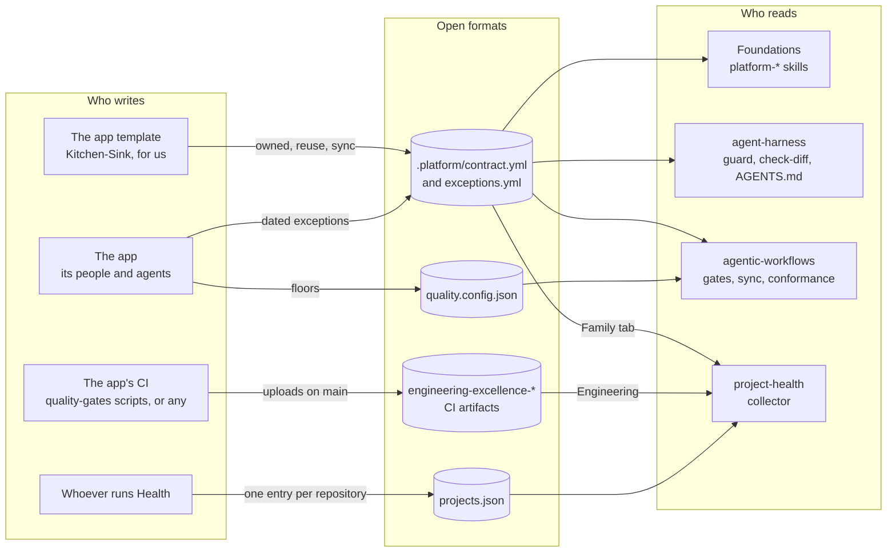
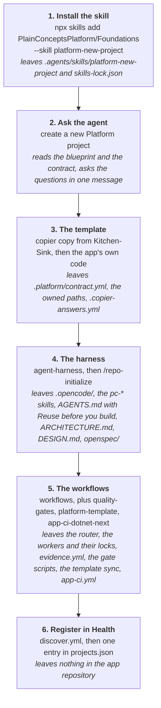
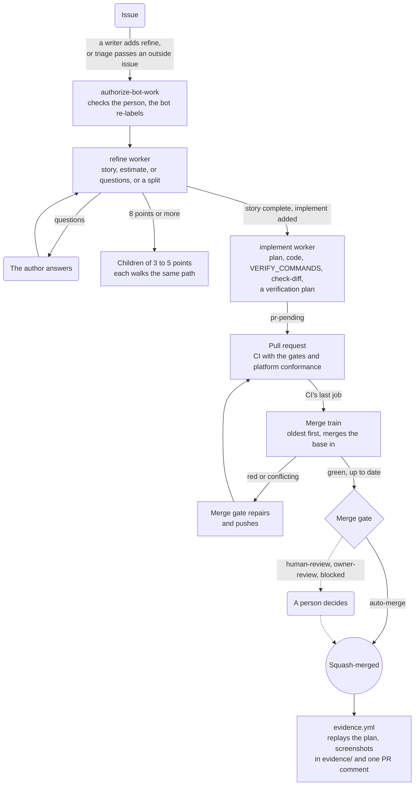
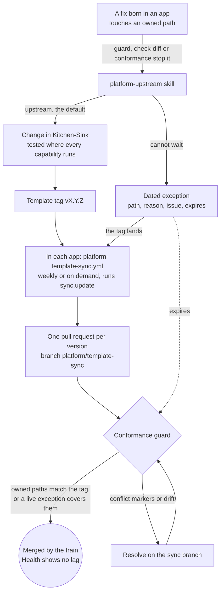
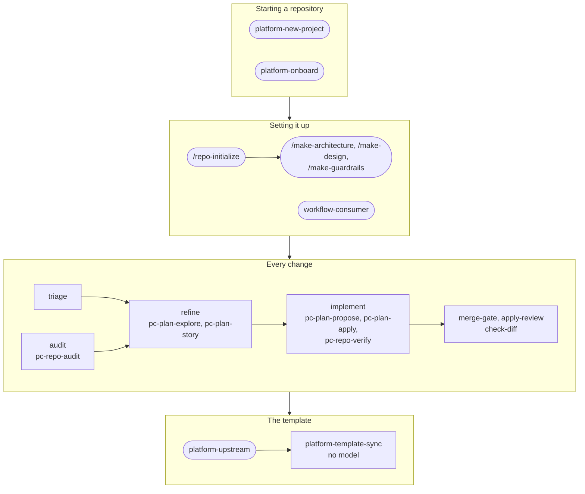

Foundations, [agent-harness](https://harness.platform.plainconcepts.dev), [agentic-workflows](https://workflows.platform.plainconcepts.dev) and [project-health](https://health.platform.plainconcepts.dev) are four independent tools. None of them imports, names or calls another, and each one works on its own. Plain Concepts chooses to use all four together, and they meet only in a handful of files whose formats are documented publicly.

That is what makes the set scale. Any organisation can adopt any one pillar: run the harness with its own CI, install the workflows in a repository that never saw the harness, keep its app template in cookiecutter or a git subtree instead of Copier, or point Health at repositories that use none of the others. Each tool reads a file it understands and ignores the rest.

<Internal>
  Kitchen-Sink, our app template, and Project-Health-Platform, the repository that holds our `projects.json`, are private.
</Internal>

## The pillars and the formats between them



| Format | Lives in | Written by | Read by | Specified in |
|---|---|---|---|---|
| `.platform/contract.yml` | The app repository | The template that delivers the shared code. The app writes only the exceptions file it points to. | Foundations' `platform-*` skills; agent-harness (the guard on owned paths, `check-diff`, the "Reuse before you build" block in `AGENTS.md`); agentic-workflows' `platform-template` (template sync and conformance guard); Health's Family tab | [agent-harness](https://harness.platform.plainconcepts.dev/docs/platform-contracts), [agentic-workflows](https://github.com/PlainConceptsPlatform/agentic-workflows/blob/main/docs/platform-contracts.md), [project-health](https://github.com/PlainConceptsPlatform/project-health#the-platform-contract) |
| `quality.config.json` | The app repository | The app: the coverage and mutation floors, just under what it measured | The gate scripts of agentic-workflows' `quality-gates` template | [agentic-workflows](https://github.com/PlainConceptsPlatform/agentic-workflows/blob/main/docs/family-templates.md#qualityconfigjson) |
| Engineering excellence facets | Workflow artifacts named `engineering-excellence-<facet>` | The app's CI on its main branch, with the `quality-gates` scripts or any producer of the schema | Health's Engineering area | [project-health](https://github.com/PlainConceptsPlatform/project-health#engineering-excellence-facets) |
| `projects.json` | Health's configuration repository | Whoever runs Health, pasting the entry `--discover` suggests | Health's collector: nothing is measured unless it is listed | [project-health](https://github.com/PlainConceptsPlatform/project-health#adding-a-project) |

Each tool has its own small reader for the contract, and no shared package. A repository without a contract, or a tool that does not know a field, behaves exactly as before; a contract that does not read gives one error naming the file and the field, never a silent pass. Health's Agentic tab also reads the markers the harness and the workflows leave in a repository (the harness version in `.opencode/harness.json`, the workflows' `Managed by` header), the same way anyone reading the repository could.

Plain Concepts' own choices live in the files, not in the tools. Kitchen-Sink's contract names Kitchen-Sink as the source, lists its platform paths under `owned`, and asks agents to reuse `docs/platform/` and the `@plainconceptsplatform/ui-components` and `@plainconceptsplatform/ui-theme` packages before building:

```yaml
version: 1
source:
  name: Kitchen-Sink platform template
  url: https://github.com/PlainConceptsPlatform/Kitchen-Sink
  changes: https://github.com/PlainConceptsPlatform/Kitchen-Sink/issues/new
owned:
  - .platform/contract.yml
  - apps/api/src/Platform/**
  - apps/web/src/shared/platform/**
  - docs/platform/**
  # ...the platform props, the platform specs, the deploy workflows, the Dockerfile
reuse:
  docs: [docs/platform/]
  packages: ["@plainconceptsplatform/ui-components", "@plainconceptsplatform/ui-theme"]
exceptions: .platform/exceptions.yml
sync:
  marker: .copier-answers.yml
  version: { file: .copier-answers.yml, key: _commit }
  update: copier update --trust --defaults --conflict inline
```

Kitchen-Sink also keeps `.platform/manifest`, one owned glob per line, as a legacy mirror for harness 3.7.0 and workflows 1.11.0, which read only that file. It goes once every app pins agent-harness 3.8.0 and workflows 1.12.0 or later. The field-by-field meaning is in [Architecture](/docs/reference/architecture#platform-family).

## A new project, step by step



<Steps>

<Step>

### Install the skill

```bash
npx skills add PlainConceptsPlatform/Foundations --skill platform-new-project
```

Always pass `--skill`: without it the CLI offers every skill in this repository, 26 of them, including the harness skills vendored under `.agents/`. The skill lands in `.agents/skills/platform-new-project/`, with a link for each agent the CLI detects (`.claude/skills/` for Claude Code) and an entry in `skills-lock.json`.

</Step>

<Step>

### Ask the agent

Ask it to *create a new Platform project*. The skill checks access to Kitchen-Sink, reads its `BLUEPRINT.md` and its `.platform/contract.yml` at the latest tag (what the template owns, what to reuse, how it syncs), and asks its questions in one message: the name, the domain, the roles, the environments. Nothing is written until the answers come back.

</Step>

<Step>

### The template

```bash
copier copy --trust -d app_name=<Name> -d app_slug=<name> --vcs-ref <latest v* tag> https://github.com/PlainConceptsPlatform/Kitchen-Sink.git .
```

Copier writes the paths the contract owns and `.copier-answers.yml`, which records the template version. Then the agent reads `docs/platform/`, the contract's `reuse.docs`, and writes the app's own code around the platform, importing the exports of the `reuse.packages` instead of writing its own. The app's catalogs (roles and permissions, sections, audit events) are app files the platform reads through its ports. So are its readiness probes, its anonymous pages and the proxies it trusts, which the platform reads from the app's configuration.

</Step>

<Step>

### The harness

```bash
npx @plainconceptsplatform/agent-harness@latest
```

Then `/repo-initialize` in OpenCode. It leaves `.opencode/`, the `pc-*` skills under `.agents/skills/`, `opencode.jsonc`, an OpenSpec workspace, and `AGENTS.md`, `ARCHITECTURE.md` and `DESIGN.md`. Because the repository now has a contract with `reuse`, `AGENTS.md` carries the "Reuse before you build" block, agents are denied edits to owned paths, and every plan needs a "What is reused" section.

</Step>

<Step>

### The workflows and the gates

```bash
npx @plainconceptsplatform/workflows@latest
npx @plainconceptsplatform/workflows@latest add --template quality-gates
npx @plainconceptsplatform/workflows@latest add --template platform-template
npx @plainconceptsplatform/workflows@latest add --template app-ci-dotnet-next
node scripts/compile-agent-workflows.mjs
```

The first leaves the router (`work-router.yml`), the workers and their compiled locks, `evidence.yml`, `opencode.ci.json` and the compile script. `quality-gates` leaves the gate scripts, the facet builder and the Semgrep, jscpd and ZAP rules; `platform-template` the weekly template sync and the conformance guard; `app-ci-dotnet-next` the gates CI, `app-ci.yml`. The app writes its own `quality.config.json` and baselines from the first CI run.

</Step>

<Step>

### Register in Health

```bash
gh workflow run discover.yml --repo PlainConceptsPlatform/Project-Health-Platform -f repo=PlainConceptsPlatform/<repo>
```

It reads the repository, finds the contract, and suggests an entry with `"family": "member"`. Paste it into `projects.json` in a pull request. Nothing changes in the app repository; Health only reads it.

</Step>

</Steps>

The full sequence, with the reason for each step, is on [Adopt in your project](/docs/adopt).

## The life of a change



Every trigger belongs to one router, `work-router.yml`, which classifies an event into one route and calls one worker. Labels are the interface: `refine` and `implement` start work, `bot-working` and `pr-pending` say where it is, and three are a person's controls: `review` parks anything for a human, `future` holds a refined issue back from implementation, and `hold` keeps a pull request off the merge train. Only what is dangerous to merge unseen waits for a person: a change under `.github/`, a secret, more than 10,000 changed lines of code, a change the agent shows cannot be undone, a verified high finding, or low confidence. A failing `check-diff` never merges either; the gate deletes what it lists and pushes, like any CI repair. When the gate parks a pull request, the evidence replay runs first and keeps a preview, so the person sees the screenshots before deciding. The contract of each route is on [AI x SDLC](/docs/ai#agentic-workflows).

## The life of the template



- **The template owns its paths.** `owned` in the contract is the list; everything else is the app's. The harness denies agent edits to owned paths, and `check-diff` reports a change to one, unless the diff is a template sync (it changes `sync.marker`) or an unexpired exception covers it.
- **A version travels down as a pull request.** `platform-template-sync.yml` reads the version from `sync.version`, runs `sync.update` (for us, `copier update --trust --defaults --conflict inline`) and opens one pull request titled with the new version. It is a bot pull request, so the merge train and the merge gate take it like any other.
- **A tag can ask the app for something.** The template cannot write app files, so a tag that needs a setting says so in a "What apps must do" section of its release notes: a proxy range, the anonymous pages, a readiness probe. The list for the recent tags is on [Adopt in your project](/docs/adopt#taking-a-new-template-version). The deploy is part of the template: its readiness gate is the smoke test, so no secret has to be set up.
- **Conformance is checked on every pull request.** `scripts/check-platform-conformance.mjs` compares the owned paths with `source.url` at the recorded version and fails on drift, on conflict markers and on an expired exception.
- **An improvement goes up first.** A fix born in an app moves into Kitchen-Sink with `platform-upstream`, ships in the next tag, and comes back to every app, the one it came from included. When the app cannot wait, it records a dated exception in `.platform/exceptions.yml`; when the exception expires, conformance fails again and someone has to decide.
- **Health watches the family.** The Family tab reads each member's contract: the template version it is on, how many tags behind the latest it is, and which owned files are identical, modified or excepted.

## Which skill runs when



Rounded nodes are run by a person asking an agent; square nodes are run by a workflow worker, on a label or a schedule. The skills come from three places, and each installs its own:

| Skill | Comes from | Runs when | Who starts it |
|---|---|---|---|
| `platform-new-project` | Foundations, with `npx skills add PlainConceptsPlatform/Foundations --skill platform-new-project` | An empty repository becomes an app | A person |
| `platform-onboard` | Foundations, `--skill platform-onboard` | An existing app joins the family, or adopts the conventions domain by domain | A person |
| `platform-upstream` | Foundations, `--skill platform-upstream` | A change touches an owned path, a sync leaves conflict markers, or conformance fails | A person, often after a guard stopped an agent |
| `pc-repo-initialize`, `pc-make-*` | agent-harness | Once after install, and again after a large change | A person, with `/repo-initialize` and the `/make-*` commands |
| `pc-plan-explore`, `pc-plan-story` | agent-harness | Refining an issue | The `refine` worker, on the `refine` label; a person with `/plan-story` |
| `pc-plan-goal`, `pc-plan-propose`, `pc-plan-apply`, `pc-repo-verify`, `pc-plan-archive` | agent-harness | Implementing an issue | The `implement` worker, on the `implement` label; a person with the `/plan-*` commands |
| `pc-repo-audit` | agent-harness | The weekly audit | The `audit` worker, on its schedule |
| `workflow-consumer` | agentic-workflows, `npx skills add PlainConceptsPlatform/agentic-workflows --skill workflow-consumer` | Installing, configuring, compiling or updating the workflows | A person |

The `platform-*` skills read the contract rather than knowing Kitchen-Sink's paths by heart, so the same skill follows the template wherever its `owned` list moves.
